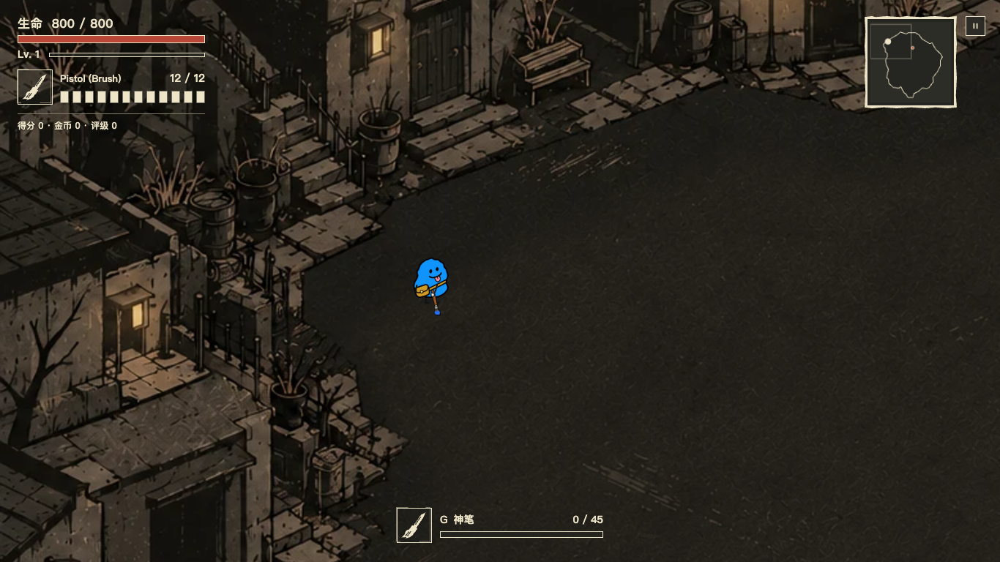
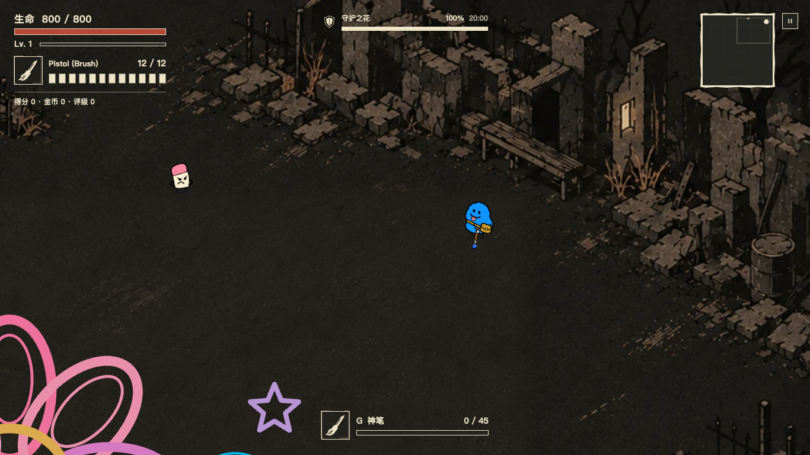
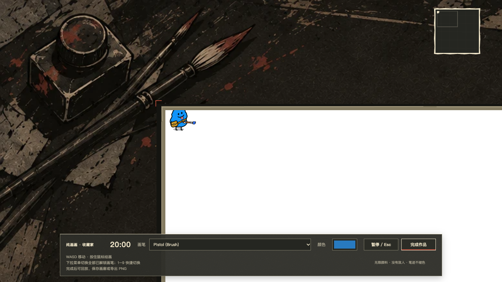
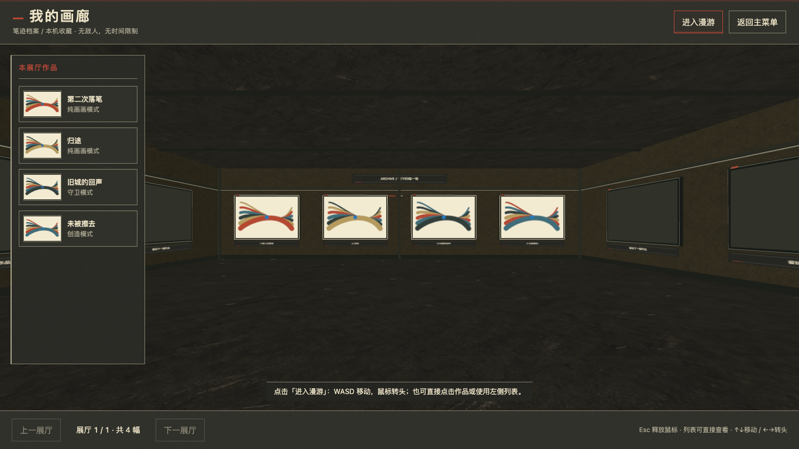

# 暗纸场景与全模式背景接入

实施日期：2026-10-17 开始，2026-10-18 完成扩展接入。用户已批准 UI 第二版；本轮沿既有方向完成创造、守卫、纯画画及画廊背景与对应 UI，不改已批准主菜单。

## 美术基准

`art-drafts/dark-paper-ui-2026-10-16/combat-ui-v2.png` 保持不覆盖。基调是暗纸、干笔、压印般的暖灰建筑块、少量锈红与米白边线。中央留给笔迹，不使用蓝夜滤镜、彩色涂鸦建筑、华丽暗金框、霓虹或卡通装饰。

| 区域 | 已接入内容 | 保持不变 |
| --- | --- | --- |
| 创造 | 荒废画室街区、深色纸地面、不规则外围建筑、局部窗灯微闪 | 2700×1800、原44点碰撞/笔迹边界 |
| 守卫 | 断墙、斜栏、枯树废墟、两处残窗微闪 | 1800×1200画板、原画/修复/擦除规则 |
| 纯画画 | 暗纸画桌、画纸外框、底部工具轨、镜头边缘留白 | 白纸与真实颜料、1800×1200导出、20分钟、收藏家、解锁武器 |
| 画廊 | 3D纸墙/地/顶、细米白展框、锈红档案标记、操作与详情/降级列表 | 第一人称漫游、10幅分页、画作数据与PNG导出 |

主菜单、准备、暂停/设置、强化、觉醒、神笔、结算和回放的上一轮实施见 `DarkPaperUIImplementation.md`。

## 资源与生成记录

本轮全部位图由内置 `image_gen` 生成，无 CLI/API fallback。源图保存于 `art-drafts/dark-paper-scenes-2026-10-17/`，以格式编码方式转换为 WebP；未覆盖任何旧美术。

| 运行文件（src/assets/paper-scenes/） | 源文件 | 实际尺寸 |
| --- | --- | --- |
| atelier-v1.webp | atelier-v1.png | 1536×1024 |
| ruins-v1.webp | ruins-v1.png | 1536×1024 |
| floor-v1.webp | floor-v1.png | 1536×1024 |
| drawing-studio-v1.webp | drawing-studio-v1.png | 1536×1024 |
| gallery-wall-v1.webp | gallery-wall-v1.png | 1281×1228 |

精确提示词：`prompts.json`（两张场景首稿与地面）、`refinement-prompts.json`（按真实边界修订）、`drawing-studio-prompt.txt`、`gallery-wall-prompt.txt`。布局约束源为 `atelier-layout.svg/png` 与 `ruins-layout.svg/png`，粉色线只用于制作，不进入运行资源。废弃的首轮场景也作为 `*-candidate-v1.png` 保留。

来源映射与编码参数记录于同目录 `README.md`。

## 渲染与隔离

- `CourtyardScene` 只绘独立 `courtyardCanvas`，不绘入 painting/trail。守卫背景范围仍为 `(-450,-300,2700,1800)`。
- `DoodleFloor` 使用 `#242019` 和低对比纸纹，精确裁剪至原玩法边界，内沿羽化。离屏缓存最长边1536，最多4份；异步纹理就绪只失效一次，无逐帧模糊或噪声构建。
- `DoodleLights` 公共接口保留，坐标重新对应新源图：创造1灯7窗，守卫2残窗。只局部 multiply 暗化，保持模拟时钟、异相平滑闪烁与减少动态效果支持。
- `DrawingScene` 复用背景canvas而不是往作品画布绘装饰。两种renderer共享canvas时检查归属；禁用战斗背景不会每帧抢走画桌归属。白纸、颜料和导出不加色调/纹理。
- `PaperGalleryRoom` 只装饰展厅与展框。作品使用中性 `MeshBasicMaterial`，不受环境灯光染色；DPR上限仍1.5，没有实时阴影。纹理延迟加载后若已退出，资源会释放，不复活已关闭的展厅。
- 所有测试使用独立浏览器context，不使用用户钱包、画廊或存档。

## 验证

- `npm run build` / TypeScript：通过。原有画廊大于500KB的构建提示仍存在，不表示构建失败。
- 场景：`test-scene-layout`、`test-floor-cache`、`test-courtyard`、`test-doodle-lights`、`test-defense-layout`、`test-paper-scenes`。
- 纯画画：`test-paper-drawing`、`test-drawing-mode`、`test-drawing-boundary`、`test-replay`。
- 画廊：`test-gallery` 三组（WebGL、无WebGL降级、context loss/释放）、`test-paper-gallery`（材质、原色像素、截图、延迟加载退出）。
- 兼容性：`test-render-performance`、`test-player-artwork`、`test-doodle-motion`、`test-doodle-skills`、`test-projectile-art`、`test-combat-audio`、`test-performance-combat`。仅补充测试打包器的WebP loader，既有断言未放宽。
- 场景20张截图覆盖两战斗模式的中心/四角与DPR1/2；画桌12张覆盖边缘、大视口和窄屏；画廊5张覆盖展厅、侧面、详情、移动端、降级列表。
- 绘画四边外溢像素为0；背景重绘前后 painting/trail/日志事件数/导出保持一致；结束回放与成品相同。画廊测试图中心RGB差异不超过2（GPU采样容差），没有色调滤镜。

## 实机审阅

截图中的彩色旧角色和守卫示例原画保持原样；不代表本轮已完成角色换装。矩形色块和展厅抽象测试画为隔离测试数据，不写入用户存档。

### 创造模式

### 守卫模式

### 纯画画

### 3D画廊

## 仍不在本轮范围

人物、怪物、武器/技能动画与音效仍是原运行版本。已确认人物候选未因此自动变成可用动画资源。未验证Electron安装包、Mac20分钟高负载性能，也未改玩法数值、实际碰撞轮廓或存档结构。
