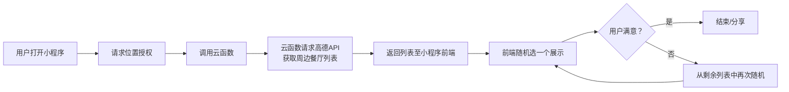

好的，以下是为你的“随机餐馆推荐小程序”项目编写的**初步需求文档**。这份文档可作为你后续开发的基线，也可用于向他人（如潜在合作者或外包）清晰传达项目范围。

---

# 项目需求文档：附近美食随机选

**版本**：V1.0 (MVP)  
**更新日期**：2026-06-02  
**作者**：你  
**项目类型**：微信小程序 + 地图API + 后端服务（可选）

---

## 1. 项目背景与目标

### 1.1 背景
许多上班族、学生等群体在用餐时间面临“选择困难”，对周边餐馆信息了解有限，决策效率低。现有的点评类App信息过载，反而加剧犹豫。

### 1.2 目标
开发一款轻量级微信小程序，基于用户当前位置，自动获取周边一定范围内的餐馆，并通过随机抽取的方式帮助用户快速做出用餐决策。用户可对结果不满意时重新随机，整个过程简单、有趣、低决策成本。

### 1.3 长期愿景（可选）
作为技术人员的个人项目，目标不仅是解决个人痛点，更期望：
- 验证本地生活类小程序的商业化可行性（广告、商家合作）。
- 积累全栈开发、产品运营经验，打造个人技术品牌。
- 在主业之外建立一项低成本的抗风险资产。

---

## 2. 用户角色

| 角色         | 描述                                                         |
| ------------ | ------------------------------------------------------------ |
| 普通用户     | 使用小程序随机选择餐馆，不满意可重新随机，可能分享给好友或查看餐馆详情。 |
| （后期）商家 | 付费获得优先展示或发放优惠券的权限（V2.0+）。                |
| 管理员       | 查看统计数据、管理广告位、处理反馈（V1.0可由开发者兼任）。   |

**MVP阶段只面向普通用户**。

---

## 3. 功能需求

### 3.1 MVP 核心功能（优先级 P0）

| 功能点           | 描述                                                         | 验收标准                                                     |
| ---------------- | ------------------------------------------------------------ | ------------------------------------------------------------ |
| **定位获取**     | 用户授权后获取当前地理位置（经纬度）。                       | 拒绝授权时提示并给出开启引导；支持手动选择位置（备选）。     |
| **周边餐馆获取** | 调用地图API（高德/腾讯）搜索周边指定半径内的“餐饮”类POI。    | 半径默认500米，可配置；返回结果包含名称、地址、经纬度、人均价格（如有）、评分（如有）、联系电话。 |
| **随机抽取**     | 从获得的餐馆列表中随机选出一条展示。                         | 展示卡片形式，包含名称、地址、大概距离；如果列表为空（如周边无餐厅）则友好提示。 |
| **重新随机**     | 用户点击“不满意，换一家”按钮，从剩余列表中重新随机（不重复抽取本轮已展示过的）。 | 若已穷尽本批次所有餐馆，则提示“试试扩大范围？”并自动扩大半径或重新拉取。 |
| **基础UI**       | 简洁、美观、操作直观。                                       | 核心按钮明显；加载状态有提示；错误有友好反馈。               |

### 3.2 扩展功能（P1 - 后续迭代）

| 功能点       | 描述                                                         |
| ------------ | ------------------------------------------------------------ |
| 筛选条件     | 按距离（500m/1km/2km）、人均价格区间、菜系等过滤。           |
| 收藏/黑名单  | 用户可收藏喜欢的餐馆，或拉黑不喜欢的，随机时自动排除黑名单。 |
| 历史记录     | 查看最近随机过的餐馆，避免短期内重复推荐。                   |
| 分享海报     | 生成“今天吃xx”的趣味分享图，可分享到朋友圈/群。              |
| 查看详情跳转 | 点击卡片跳转到地图App（高德/腾讯/Apple Maps）查看路线或拨打电话。 |
| 广告变现     | 接入激励视频（额外随机次数）、Banner广告、插屏广告。         |

> MVP阶段**不实现**：用户登录、收藏、筛选、后端用户系统。

---

## 4. 非功能需求

| 需求项 | 具体要求                                                     |
| ------ | ------------------------------------------------------------ |
| 性能   | 从打开到首次出现随机结果不超过3秒（正常网络下）；随机响应不超过0.5秒。 |
| 可用性 | 操作步骤 ≤ 3步即可完成一次“随机-不满意-再随机”闭环；字体大小适配弱视。 |
| 兼容性 | 支持微信最新版及主流iOS/Android系统；覆盖iPhone 6s及以上、Android 8.0及以上。 |
| 安全性 | 地图API密钥存放于后端云函数，不暴露在前端；用户位置仅本地使用，不上传第三方。 |
| 扩展性 | 代码结构清晰，后续可方便添加新筛选条件、广告组件。           |

---

## 5. 技术选型建议（基于你是技术人员）

| 层级         | 推荐方案                              | 理由                                                |
| ------------ | ------------------------------------- | --------------------------------------------------- |
| 小程序框架   | 微信小程序原生开发                    | 性能最好，调试方便，官方支持完善。                  |
| 后端服务     | 微信云开发（云函数 + 云数据库）       | 零运维，免费额度够用，天然解决密钥隐藏问题。        |
| 地图API      | 高德地图Web服务 API（或腾讯位置服务） | 高德个人开发者每日5万次免费调用；腾讯也有类似额度。 |
| 前端地图展示 | 小程序内置地图组件 `<map>`            | 简单展示位置，无需额外SDK。                         |
| 版本管理     | Git + GitHub/Gitee                    | 便于备份和展示项目。                                |

---

## 6. 数据流简图（逻辑示意）

---

## 7. 开发与发布计划（个人业余时间）

| 阶段               | 预计时间                          | 产出                                                   |
| ------------------ | --------------------------------- | ------------------------------------------------------ |
| 环境搭建 & API申请 | 第1周周末（2小时）                | 微信开发者工具、高德/腾讯开发者账号、云开发环境配置。  |
| 核心功能编码       | 第2-3周（每晚1-2小时 + 周末半天） | 实现定位、搜索、随机、重随机；基本UI。                 |
| 调试与真机测试     | 第4周（碎片时间）                 | 修复Bug；邀请5-10人内测。                              |
| 小程序提交审核     | 第5周                             | 通过后上线（注意个人主体类目选择“生活服务”或“工具”）。 |
| 运营小版本迭代     | 上线后持续                        | 根据反馈增加分享、广告等。                             |

> 若时间受限，可延长到6-8周，保持每周固定投入即可。

---

## 8. 风险与依赖

| 风险                                       | 缓解措施                                                     |
| ------------------------------------------ | ------------------------------------------------------------ |
| 地图API调用超限                            | 个人开发者免费额度足够初期；可在云函数中加入缓存（同一用户30分钟内重复请求直接返回缓存列表）。 |
| 用户位置授权失败                           | 提供手动输入城市或坐标的后备方案（MVP阶段可提示无法使用）。  |
| 周边餐馆数据质量差（如关门店铺仍在列表中） | 依赖地图API数据；后期可增加“反馈已关闭”功能。                |
| 微信审核驳回                               | 提前阅读小程序审核规范，避免强求用户授权、避免诱导分享。     |
| 时间挤占主业                               | 使用时间追踪工具，设定每周最大投入时长（如不超过10小时）。   |

---

## 9. 成功度量（MVP阶段）

| 指标                 | 目标值                         |
| -------------------- | ------------------------------ |
| 上线后一个月累计用户 | ≥ 500人（通过群、朋友圈获取）  |
| 平均会话时长         | > 1分钟（多次随机 + 查看详情） |
| 次日留存             | > 20%（趣味性够强）            |
| 错误率               | < 1%（定位失败/接口超时等）    |

---

## 10. 附录：参考资料与接口文档

- [微信小程序开发文档](https://developers.weixin.qq.com/miniprogram/dev/framework/)
- [微信云开发文档](https://developers.weixin.qq.com/miniprogram/dev/wxcloud/basis/getting-started.html)
- [高德地图Web服务API – 周边搜索](https://lbs.amap.com/api/webservice/guide/api/search)
- [腾讯位置服务WebService API – 地点搜索](https://lbs.qq.com/service/webService/webServiceGuide/webServiceSearch)

